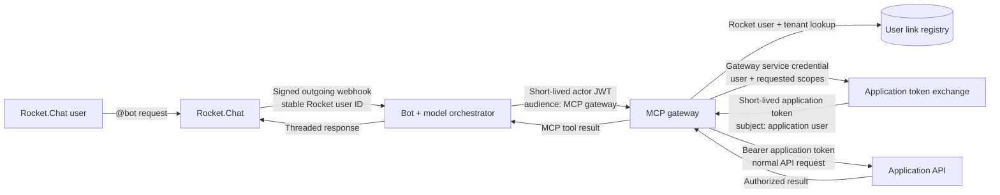

# Architecture and trust boundaries



## Token boundaries

| Credential | Issuer and audience | Used only for |
|---|---|---|
| Rocket.Chat webhook token | Rocket.Chat integration → bot | Authenticating webhook delivery |
| Actor JWT | Bot → MCP gateway | Binding a short-lived MCP request to the Rocket user, tenant, room, and request |
| Gateway service token | Application administrator → token-exchange endpoint | Authenticating the trusted gateway itself |
| Application access token | Application auth server → application API | Authorizing the linked application user and scopes |

The gateway never sends application tokens to the model, Rocket.Chat, MCP tool arguments, or logs. The application does not trust `X-User-ID`; it derives the actual user and permissions from the application access token it issued.

## Application contract

The reference gateway expects one delegated token endpoint:

```http
POST /api/auth/mcp-token
Authorization: Bearer <gateway-service-token>
Content-Type: application/json

{
  "applicationUserId": "A456",
  "requestedScopes": ["tickets:read"],
  "actor": {
    "rocketUserId": "R123",
    "tenantId": "default",
    "roomId": "ROOM",
    "requestId": "MESSAGE"
  }
}
```

The application must authenticate the gateway, verify that the linked application user is active, restrict the requested scopes, and issue a short-lived token whose audience is the application API. The application API then applies its normal authorization rules.

If the application already exposes OAuth Authorization Code/OIDC, replace the token-exchange adapter with an OAuth account-linking adapter. The MCP and bot boundaries remain the same.

## Generic API tools

`gateway/config/tools.json` is an explicit allow-list. Each tool defines its JSON Schema, required scopes, HTTP method, application-relative path, and permitted path/query/body fields. Arbitrary URLs, headers, and unlisted input fields are not forwarded.

`gateway/config/user-links.json` is a development registry connecting `(tenantId, rocketUserId)` to an application user and maximum scopes. Replace it with a database-backed repository and administrative account-linking UI for production.
